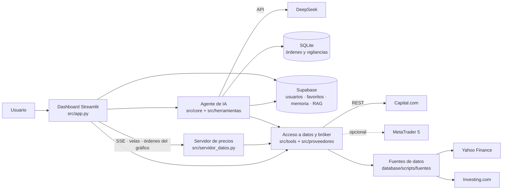

# RepAgenteIA — Plataforma de trading con agente de IA bursátil

Proyecto de título (Capstone 2026 · sección 002D · equipo 11).

## 1. Descripción del proyecto

RepAgenteIA es una plataforma web de trading para operar y analizar activos financieros (divisas, metales, índices, criptomonedas y acciones), con un **agente de inteligencia artificial** integrado para el análisis bursátil.

El agente es capaz de consultar datos de mercado y noticias, calcular indicadores, resumir información, guardar memoria de las conversaciones con el usuario y entregar análisis e ideas de inversión según el estado del mercado.

**El agente no opera por su cuenta.** Solo *propone* órdenes, que se validan contra límites de riesgo definidos en el código (no en el prompt) y quedan registradas con su justificación. Únicamente el usuario, con el botón «Confirmar» de la plataforma, envía una orden al bróker.

### Funcionalidades principales

- **Gráfico interactivo** con velas, indicadores, herramientas de dibujo, backtesting con replay y órdenes sobre el gráfico.
- **Precios en vivo** (streaming) y profundidad de mercado.
- **Panel de órdenes** y **operación con un clic**, con gestión de posiciones, stop dinámico (trailing) y órdenes OCO.
- **Cartera, diario de operaciones y estadísticas** del portafolio.
- **Mercados, favoritos y lista de activos** por usuario.
- **Noticias financieras** de varias fuentes (RSS, español e inglés), con lectura dentro de la plataforma.
- **Copytrading**: catálogo de estrategias.
- **Chat con el agente de IA**: razona, usa herramientas (técnicas, cuantitativas, de riesgo, macroeconomía, sentimiento, gráficos y tablas), propone órdenes y crea vigilancias de mercado.
- **Acceso con usuarios** (registro e inicio de sesión) y memoria del agente por usuario.

## 2. Tecnologías utilizadas

- **Lenguajes:** Python, JavaScript, CSS, HTML, SQL
- **Frameworks / librerías:** Streamlit (interfaz), pandas y NumPy (cálculo), matplotlib (gráficos del agente), requests y websockets (red), trafilatura (lectura de noticias)
- **Inteligencia artificial:** API de DeepSeek (cliente `openai`), con perfiles `rapido`, `analisis` y `profundo`
- **Base de datos:** Supabase / PostgreSQL (usuarios, favoritos, memoria y base de conocimiento) y SQLite local (órdenes y vigilancias del agente)
- **Fuentes de datos y bróker:** Capital.com (API REST), MetaTrader 5, Yahoo Finance (`yfinance`) e Investing.com

## 3. Instrucciones para ejecutar el proyecto localmente

### Requisitos

- Python 3.10 o superior y `git`.
- Cuenta de **Capital.com** (demo gratis) con 2FA activo y una API key, **o** el terminal MetaTrader 5 en Windows.
- API key de **DeepSeek**.
- Proyecto de **Supabase** (URL y clave) para el login, los favoritos y la memoria del agente.

### Instalación (Windows)

```bash
# 1. Clonar el repositorio
git clone https://github.com/Cristian-Higuera-byte/RepAgenteIA.git
cd RepAgenteIA/capstone-2026-002D-equipo11

# 2. Crear y activar el entorno virtual
python -m venv env
env\Scripts\activate

# 3. Instalar las dependencias
python -m pip install --upgrade pip
python -m pip install streamlit pandas numpy python-dotenv requests yfinance openai supabase matplotlib certifi trafilatura websockets curl_cffi
python -m pip install MetaTrader5     # solo si usas MetaTrader 5 (únicamente Windows)
```

En Linux o macOS: `python3 -m venv env`, `source env/bin/activate` y la misma lista de librerías (sin `MetaTrader5`).

Si PowerShell bloquea la activación del entorno, ejecuta una vez `Set-ExecutionPolicy -Scope CurrentUser RemoteSigned`, o usa `env\Scripts\activate.bat` desde `cmd`.

### Variables de entorno

Crea un archivo `.env` dentro de `capstone-2026-002D-equipo11/`. **Está excluido de git y nunca debe subirse.**

```env
# Inteligencia artificial
DEEPSEEK_API_KEY=sk-...
# DEEPSEEK_BASE_URL=https://api.deepseek.com      (opcional)

# Bróker: "capital" (API REST, sin terminal) o "mt5" (terminal MetaTrader 5)
PROVEEDOR=capital

# Capital.com (si PROVEEDOR=capital)
CAPITAL_DEMO=true                                  # true = cuenta demo, false = cuenta real
CAPITAL_API_KEY=...
CAPITAL_IDENTIFIER=correo@ejemplo.com              # correo de la cuenta
CAPITAL_API_PASSWORD=...                           # contraseña definida al crear la API key

# MetaTrader 5 (si PROVEEDOR=mt5)
# MT5_PATH=C:\Program Files\MetaTrader 5\terminal64.exe

# Supabase (login, favoritos, memoria y conocimiento)
SUPABASE_URL=https://xxxx.supabase.co
SUPABASE_KEY=...

# Opcional: dirección del servidor de precios (por defecto http://localhost:8000)
# MT5_API_URL=http://localhost:8000
```

> La contraseña de `CAPITAL_API_PASSWORD` es la que se define al **crear la API key**, no la de la cuenta. Capital.com exige 2FA activo para generar la key.

### Ejecución

Se usan **dos terminales**, ambas desde `capstone-2026-002D-equipo11/` y con el entorno virtual activado:

```bash
# Terminal 1 — dashboard (http://localhost:8501)
python -m streamlit run src/app.py

# Terminal 2 — servidor de precios en vivo, velas y órdenes del gráfico (http://localhost:8000)
python src/servidor_datos.py
```

Sin el servidor de precios la plataforma abre, pero sin el streaming en vivo del gráfico.

Para probar el agente sin abrir el dashboard (chat por terminal):

```bash
python src/main.py
```

### Acceso y credenciales de prueba

1. Abre http://localhost:8501.
2. Regístrate con un correo y una contraseña (el usuario se guarda en Supabase) e inicia sesión.
3. Con `CAPITAL_DEMO=true` las operaciones se hacen sobre una **cuenta demo**, sin dinero real.

### Solución de problemas

| Síntoma | Causa probable |
|---|---|
| `Falta DEEPSEEK_API_KEY` | No está definida en el `.env` o el archivo no está en `capstone-2026-002D-equipo11/`. |
| `Faltan credenciales en el .env` (Capital) | Revisa `CAPITAL_API_KEY`, `CAPITAL_IDENTIFIER` y `CAPITAL_API_PASSWORD`. HTTP 401 suele ser un error en el correo o en la contraseña de la API key. |
| `No se encontró ningún terminal64.exe` | Con `PROVEEDOR=mt5`, define `MT5_PATH` con la ruta de `terminal64.exe`. |
| `supabase_url is required` | Faltan `SUPABASE_URL` / `SUPABASE_KEY` en el `.env`. |
| El gráfico no se actualiza en vivo | El servidor de precios (terminal 2) no está corriendo. |
| `ModuleNotFoundError` | El entorno virtual no está activo o faltan librerías del paso de instalación. |

## 4. Integrantes del equipo y roles

| Integrante | Rol |
|---|---|
| Cristian Higuera | Líder de proyecto / Backend / Base de datos / Diseño |
| Joaquín Allendes | Frontend / QA |

## 5. Metodología de trabajo

> **Por completar por el equipo:** indicar si se trabajó con Scrum, Kanban u otra metodología, las ceremonias o reuniones realizadas y la herramienta del tablero (por ejemplo Trello, Jira o GitHub Projects).

El control de versiones se hace con Git y GitHub. La bitácora de avances del desarrollo está en [`docs/_registro_avances_bursatil.md`](capstone-2026-002D-equipo11/docs/_registro_avances_bursatil.md).

## 6. Arquitectura de la solución



### Estructura del repositorio

```
capstone-2026-002D-equipo11/
├── src/
│   ├── app.py                  Lanzador del dashboard (Streamlit)
│   ├── main.py                 Chat del agente por terminal
│   ├── servidor_datos.py       Lanzador del servidor de precios en vivo
│   ├── configuracion.py        Configuración central (modelos, rutas, .env)
│   ├── aplicacion_principal/   Armado de la página: estilos, vistas y fragmentos
│   ├── components/             Paneles de la interfaz (gráfico, órdenes, cartera, noticias, chat...)
│   ├── core/                   Núcleo del agente: LLM, memoria, órdenes, vigilancia, turnos
│   ├── herramientas/           Herramientas que el agente puede usar (análisis, riesgo, macro...)
│   ├── tools/                  Acceso a datos y servicios: bróker, Supabase, almacenes locales
│   ├── proveedores/            Selector de bróker (Capital.com / MetaTrader 5)
│   ├── servidor_precios/       Servidor de precios en vivo, velas, OCO y stop dinámico
│   └── prompts/                Prompt de sistema del agente
├── database/
│   ├── scripts/fuentes/        Fuentes de datos: MetaTrader 5, Yahoo Finance e Investing.com
│   ├── sql/                    Esquemas SQL de órdenes y vigilancias
│   └── data/                   Datos locales generados (no se suben a git)
├── docs/                       Evidencias de las fases del proyecto y bitácora de avances
└── tests/                      Pruebas y scripts de diagnóstico
```

### Seguridad

- El agente **solo propone** órdenes; solo el usuario las confirma.
- Los límites de riesgo están en el código y el modelo no puede modificarlos.
- Cada propuesta queda registrada con su justificación como auditoría, y existe un interruptor de emergencia (*kill switch*).
- Las credenciales viven solo en el `.env`, que no se sube a git.

---

### Sección de innovación (documento de cierre)

> Borrador a partir de lo desarrollado; el equipo debe revisarlo y ajustarlo antes de la entrega.

- **¿Qué problema resuelve?** Quien opera en bolsa debe cruzar a mano gráficos, indicadores, noticias y gestión de riesgo en varias herramientas distintas. Eso consume tiempo, favorece las decisiones impulsivas y es difícil para quien está empezando.
- **¿Qué hace diferente a la solución?** Reúne en una sola plataforma el gráfico, la operación y un agente de IA que analiza con datos reales (precios, noticias, indicadores y la cartera del usuario) en lugar de responder de memoria. El agente propone y justifica, pero la decisión de ejecutar es siempre del usuario, bajo límites de riesgo definidos en el código.
- **¿Qué valor agrega?** Ahorra tiempo de análisis, aporta una segunda opinión razonada y trazable (cada propuesta queda auditada) y reduce el riesgo operativo con límites de riesgo, confirmación manual y un interruptor de emergencia. Además, se conecta por API a Capital.com, por lo que no depende de un terminal instalado ni de Windows.
