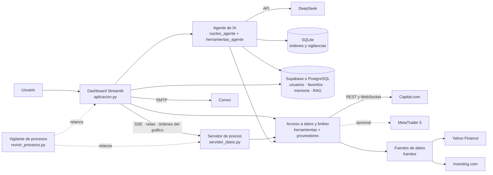

# RepAgenteIA — Plataforma de trading con agente de IA bursátil

Proyecto de título (Capstone 2026 · sección 002D · equipo 11) · Duoc UC, Sede Valparaíso.

## Índice

1. [Descripción del proyecto](#1-descripción-del-proyecto)
2. [Estado del proyecto](#2-estado-del-proyecto)
3. [Tecnologías utilizadas](#3-tecnologías-utilizadas)
4. [Estructura del repositorio](#4-estructura-del-repositorio)
5. [Instrucciones para ejecutar el proyecto localmente](#5-instrucciones-para-ejecutar-el-proyecto-localmente)
6. [Despliegue en un hosting](#6-despliegue-en-un-hosting)
7. [Integrantes del equipo y roles](#7-integrantes-del-equipo-y-roles)
8. [Metodología de trabajo](#8-metodología-de-trabajo)
9. [Arquitectura de la solución](#9-arquitectura-de-la-solución)
10. [Seguridad](#10-seguridad)
11. [Sección de innovación](#11-sección-de-innovación)

---

## 1. Descripción del proyecto

RepAgenteIA es una plataforma web de trading para operar y analizar activos financieros (divisas, metales, índices, criptomonedas y acciones), con un **agente de inteligencia artificial** integrado para el análisis bursátil. El sistema nace en la empresa Piña y Jara Transportes y Servicios Ltda., que planteó el desafío de contar con herramientas avanzadas para la toma de decisiones financieras usando inteligencia artificial.

El agente consulta datos de mercado y noticias, calcula indicadores, resume información, guarda memoria de las conversaciones con cada usuario y entrega análisis e ideas de inversión según el estado del mercado.

**El agente no opera por su cuenta.** Solo *propone* órdenes, que se validan contra límites de riesgo definidos en el código (no en el prompt) y quedan registradas con su justificación. Únicamente el usuario, con el botón «Confirmar» de la plataforma, envía una orden al bróker.

### Funcionalidades principales

- **Gráfico interactivo** con velas, indicadores, herramientas de dibujo, backtesting con replay y órdenes sobre el gráfico.
- **Precios en vivo** (streaming) y profundidad de mercado.
- **Panel de órdenes** y **operación con un clic**, con gestión de posiciones, stop dinámico (trailing) y órdenes OCO.
- **Cartera, resumen de cuenta y diario de operaciones** con métricas del portafolio.
- **Mercados, favoritos y lista de activos** por usuario.
- **Noticias financieras** de varias fuentes (RSS, español e inglés), con lectura dentro de la plataforma.
- **Copy trading**: catálogo de estrategias.
- **Chat con el agente de IA**: razona, usa herramientas (técnicas, cuantitativas, de riesgo, macroeconomía, sentimiento, gráficos y tablas), propone órdenes y crea vigilancias de mercado. Tiene un chat flotante y una portada de presentación.
- **Cuentas de usuario**: registro con verificación de correo, recuperación de contraseña, contraseña fuerte, sesión persistente, perfil y cierre de sesión en todos los dispositivos. Cada usuario conecta su propia cuenta de Capital.com (demo o real) y puede quitarla cuando quiera.
- **Planes de uso del agente y billetera de prueba** (modo de prueba: no se cobra dinero real).
- **Uso en celular y tablet** (interfaz adaptada, con dibujo táctil en el gráfico).
- **Términos de uso, privacidad, aviso de riesgo y soporte** dentro de la plataforma.

## 2. Estado del proyecto

Corte al **4 de noviembre de 2026** (semana 14 de 18). El proyecto se organiza en 9 sprints de 2 semanas y se entrega en la semana 18.

| Fase | Estado |
|---|---|
| Fase 1 · Definición, backlog y planificación | Completada |
| Fase 2 · MVP operativo sobre Capital.com | Cerrada el 23/10 |
| Fase 3 · Acceso seguro, publicación, pruebas y entrega final | En curso (Sprint 7) |

- **Product Backlog:** 12 épicas y 50 historias de usuario (276 puntos). Hechas: 34 historias (179 puntos).
- **Pendiente para la entrega final:** modelo de datos y diagramas UML, requisitos no funcionales, Docker, plan y pruebas (unitarias, de integración, de rendimiento, de seguridad y de usabilidad), manual técnico, evaluación de alucinaciones del agente e informe final.
- **Tablero de tareas:** [Trello · RepAgenteIA - Capstone](https://trello.com/b/QPZrJH9t/repagenteia-capstone).
- **Evidencias de la Fase 2:** carpeta `FASE 2/` (guía de la fase, diarios y autoevaluaciones, sistema y documentación).

## 3. Tecnologías utilizadas

- **Lenguajes:** Python, JavaScript, CSS, HTML, SQL
- **Frameworks / librerías:** Streamlit (interfaz), pandas y NumPy (cálculo), matplotlib (gráficos del agente), requests y websockets (red), trafilatura (lectura de noticias), cryptography (cifrado de credenciales)
- **Inteligencia artificial:** API de DeepSeek (cliente `openai`), con perfiles `rapido`, `analisis` y `profundo`
- **Base de datos:** Supabase o PostgreSQL, a elección con la variable `BASE_DATOS` (usuarios, perfiles, favoritos, billetera, memoria del agente y base de conocimiento), y SQLite local (órdenes y vigilancias del agente)
- **Fuentes de datos y bróker:** Capital.com (API REST y WebSocket), Yahoo Finance (`yfinance`) e Investing.com. MetaTrader 5 queda como proveedor opcional (solo Windows).
- **Correo:** envío por SMTP (confirmación de correo y recuperación de contraseña)
- **Gestión del proyecto:** Scrum, Trello, GitHub y Visual Studio Code

## 4. Estructura del repositorio

```
RepAgenteIA/
├── README.md
├── FASE 1/
│   ├── EVIDENCIAS GRUPALES/              Guía de la fase, formativa y presentación de la Fase 1
│   └── EVIDENCIAS INDIVIDUALES/          Autoevaluaciones y diarios de reflexión
└── FASE 2/
    ├── Grupales/                         Guía 2.4 de la Fase 2 (español e inglés)
    ├── Individuales/                     Diarios de reflexión y autoevaluaciones
    └── Evidencias proyecto/
        ├── Evidencia de sistema/
        │   └── Proyecto Agente de IA bursatil/    Código fuente de la plataforma
        └── Evidencia de documentación/            Metodología Scrum, informe de investigación y capturas
```

### El sistema (`Proyecto Agente de IA bursatil/`)

```
Proyecto Agente de IA bursatil/
├── aplicacion.py                Lanzador del dashboard (Streamlit)
├── consola_agente.py            Chat del agente por terminal
├── servidor_datos.py            Lanzador del servidor de precios en vivo
├── configuracion.py             Configuración central (modelos, rutas, .env)
├── revivir_procesos.py          Vigilante que relanza el dashboard y el servidor de precios si se caen
├── mantenimiento.html           Página que se muestra cuando la plataforma está caída (error 503)
├── aplicacion_principal/        Armado de la página: estilos, vistas y fragmentos
├── componentes_plataforma/      Paneles de la interfaz: gráfico, órdenes, cartera, noticias, chat, acceso, perfil, planes, soporte...
├── nucleo_agente/               Núcleo del agente: modelo de lenguaje, memoria, órdenes, vigilancia y turnos
├── herramientas_agente/         Herramientas que el agente puede usar (análisis, riesgo, macro, sentimiento, gráficos...)
├── herramientas/                Acceso a datos y servicios: bróker, base de datos, correo, credenciales, sesiones y esquemas SQL
├── proveedores/                 Selector de bróker (Capital.com / MetaTrader 5)
├── servidor_precios/            Servidor de precios en vivo, velas, OCO y stop dinámico
├── fuentes/                     Fuentes de datos: Yahoo Finance, Investing.com y MetaTrader 5
├── prompts/                     Prompt de sistema del agente
├── despliegue/                  Plantilla del .htaccess para el hosting
├── .streamlit/                  Configuración de Streamlit
└── requirements.txt             Lista de dependencias (ver nota en la sección 5)
```

## 5. Instrucciones para ejecutar el proyecto localmente

### Requisitos

- Python 3.11 o superior (la plataforma se desarrolló con 3.12) y `git`.
- Cuenta de **Capital.com** (demo gratis) con 2FA activo y una API key.
- API key de **DeepSeek**.
- Una base de datos: un proyecto de **Supabase** (URL y clave) o un **PostgreSQL**.
- Opcional: una cuenta de correo SMTP, para la verificación de correo y la recuperación de contraseña.

### Instalación (Windows, PowerShell)

```powershell
# 1. Clonar el repositorio y entrar a la carpeta del sistema
git clone https://github.com/Cristian-Higuera-byte/RepAgenteIA.git
cd "RepAgenteIA\FASE 2\Evidencias proyecto\Evidencia de sistema\Proyecto Agente de IA bursatil"

# 2. Crear y activar el entorno virtual
python -m venv env
env\Scripts\activate

# 3. Instalar las dependencias
python -m pip install --upgrade pip
python -m pip install streamlit pandas numpy python-dotenv requests websockets yfinance openai supabase matplotlib certifi trafilatura cryptography curl_cffi
python -m pip install psycopg2-binary   # solo si usas PostgreSQL (BASE_DATOS=postgres)
python -m pip install MetaTrader5       # solo si usas MetaTrader 5 (únicamente Windows)
```

> **Nota:** el archivo `requirements.txt` del proyecto todavía no se puede instalar con `pip install -r` (contiene comandos `pip` en lugar de paquetes). Por eso las dependencias se instalan con el comando del paso 3; corregir ese archivo está en el plan del Sprint 8.

En Linux o macOS: `python3 -m venv env`, `source env/bin/activate` y la misma lista de librerías (sin `MetaTrader5`).

Si PowerShell bloquea la activación del entorno, ejecuta una vez `Set-ExecutionPolicy -Scope CurrentUser RemoteSigned`, o usa `env\Scripts\activate.bat` desde `cmd`.

### Variables de entorno

Crea un archivo `.env` dentro de la carpeta del sistema. **Está excluido de git y nunca debe subirse.** Para una prueba local con una sola cuenta basta el bloque mínimo; los demás son opcionales.

```env
# ── Mínimo para una prueba local ─────────────────────────────────────
DEEPSEEK_API_KEY=sk-...
# DEEPSEEK_BASE_URL=https://api.deepseek.com      (opcional)

# Bróker: "capital" (API REST, sin terminal) o "mt5" (terminal MetaTrader 5)
PROVEEDOR=capital
CAPITAL_DEMO=true                                  # true = cuenta demo, false = cuenta real
CAPITAL_API_KEY=...
CAPITAL_IDENTIFIER=correo@ejemplo.com              # correo de la cuenta
CAPITAL_API_PASSWORD=...                           # contraseña definida al crear la API key

# Base de datos: "supabase" (por defecto) o "postgres"
BASE_DATOS=supabase
SUPABASE_URL=https://xxxx.supabase.co
SUPABASE_KEY=...

# ── Opcional: base de datos PostgreSQL (si BASE_DATOS=postgres) ──────
# POSTGRES_SERVIDOR=...
# POSTGRES_PUERTO=5432
# POSTGRES_BASE_DATOS=...
# POSTGRES_USUARIO=...
# POSTGRES_CONTRASENA=...

# ── Opcional: modo multiusuario (cada usuario conecta su cuenta de Capital.com) ──
# CAPITAL_MULTIUSUARIO=true
# SERVIDOR_SECRETO=...                 # mínimo 32 caracteres; firma los tokens del servidor de precios
# CREDENCIALES_CLAVES=...              # clave Fernet que cifra las credenciales guardadas (ver abajo)
# CAPITAL_MAX_SESIONES=200           # máximo de sesiones de usuario que se mantienen en memoria (opcional; 200 por defecto)
# SERVIDOR_ORIGENES=mi-dominio.cl      # dominios desde los que se consulta el servidor de precios (solo en producción)

# ── Opcional: correo (verificación de correo y recuperación de contraseña) ──
# VERIFICACION_CORREO=true
# PLATAFORMA_URL=https://mi-dominio.cl           # dirección pública que va en los enlaces del correo
# CORREO_SERVIDOR=smtp.ejemplo.com
# CORREO_PUERTO=465                              # 465 (ssl) o 587 (starttls)
# CORREO_SEGURIDAD=ssl
# CORREO_USUARIO=buzon@ejemplo.com
# CORREO_CLAVE=...
# CORREO_REMITENTE=Nombre que ve quien recibe
# SOPORTE_CORREO=soporte@ejemplo.com             # destino de los reportes de soporte (si falta, se usa CORREO_USUARIO)

# ── Opcional: dirección del servidor de precios (por defecto http://localhost:8000) ──
# MT5_API_URL=http://localhost:8000
# MT5_PATH=C:\Program Files\MetaTrader 5\terminal64.exe   # solo con PROVEEDOR=mt5
```

- La contraseña de `CAPITAL_API_PASSWORD` es la que se define al **crear la API key**, no la de la cuenta. Capital.com exige 2FA activo para generar la key.
- Para generar `CREDENCIALES_CLAVES`: `python -c "from cryptography.fernet import Fernet; print(Fernet.generate_key().decode())"`. **No cambies esa clave una vez que haya cuentas guardadas**, o dejarán de poder descifrarse.
- Con `CAPITAL_MULTIUSUARIO` apagado, la plataforma usa la cuenta definida en el `.env`.

### Base de datos

Los esquemas SQL están en `herramientas/sql/`. Se ejecutan una vez en la base elegida (en el *SQL Editor* de Supabase o con `psql` / phpPgAdmin en PostgreSQL):

- **Supabase:** `esquema_plataforma.sql` y, según lo que uses, `usuarios_supabase.sql`, `perfiles_usuario.sql`, `planes_usuario.sql`, `billetera.sql`, `copytrading.sql`, `copytrading_comisiones.sql`, `notificaciones.sql`, `sesiones_persistentes.sql`, `verificacion_correo.sql` y `aceptaciones_legales.sql`.
- **PostgreSQL:** `postgresql_cpanel_completo.sql` (todas las tablas base), más `verificacion_correo.sql` y `aceptaciones_legales.sql`.

Las órdenes y vigilancias del agente se guardan en un SQLite local que se crea solo.

### Ejecución

Se usan **dos terminales**, ambas desde la carpeta del sistema y con el entorno virtual activado:

```powershell
# Terminal 1 — dashboard (http://localhost:8501)
python -m streamlit run aplicacion.py

# Terminal 2 — servidor de precios en vivo, velas y órdenes del gráfico (http://localhost:8000)
python servidor_datos.py
```

Sin el servidor de precios la plataforma abre, pero sin el streaming en vivo del gráfico.

Para probar el agente sin abrir el dashboard (chat por terminal):

```powershell
python consola_agente.py
```

### Acceso y credenciales de prueba

1. Abre http://localhost:8501.
2. Regístrate con un correo y una contraseña fuerte (8 o más caracteres, con mayúscula, minúscula, número y símbolo). Si `VERIFICACION_CORREO=true`, confirma tu correo con el enlace que llega a tu bandeja.
3. Inicia sesión. Con `CAPITAL_DEMO=true` (o conectando una cuenta demo) las operaciones se hacen sobre una **cuenta demo**, sin dinero real.
4. Antes de operar, la plataforma te pide aceptar los términos de uso, la privacidad y el aviso de riesgo.

### Solución de problemas

| Síntoma | Causa probable |
|---|---|
| `Falta DEEPSEEK_API_KEY` | No está definida en el `.env` o el archivo no está en la carpeta del sistema. |
| `Faltan credenciales en el .env` (Capital) | Revisa `CAPITAL_API_KEY`, `CAPITAL_IDENTIFIER` y `CAPITAL_API_PASSWORD`. HTTP 401 suele ser un error en el correo o en la contraseña de la API key. |
| `No se encontró ningún terminal64.exe` | Con `PROVEEDOR=mt5`, define `MT5_PATH` con la ruta de `terminal64.exe`. |
| `supabase_url is required` | Faltan `SUPABASE_URL` / `SUPABASE_KEY` en el `.env` (o `BASE_DATOS` apunta a un motor que no configuraste). |
| `Falta configurar el servidor: SERVIDOR_SECRETO` | En modo multiusuario falta `SERVIDOR_SECRETO` (mínimo 32 caracteres). |
| El correo de verificación no llega | Faltan variables `CORREO_*` o `PLATAFORMA_URL`; revisa el puerto (465 con `ssl`, 587 con `starttls`). |
| El gráfico no se actualiza en vivo | El servidor de precios (terminal 2) no está corriendo. |
| `ModuleNotFoundError` | El entorno virtual no está activo o faltan librerías del paso de instalación (por ejemplo `psycopg2-binary` si usas PostgreSQL). |
| Error de certificados SSL en Windows | Ocurre si la ruta del proyecto tiene tildes; usa una copia del certificado en una ruta sin tildes. |

## 6. Despliegue en un hosting

La plataforma se publicó en un hosting cPanel con PostgreSQL. Lo esencial:

- **Procesos:** el dashboard (Streamlit) y el servidor de precios corren como procesos propios; Streamlit necesita WebSocket, por lo que el hosting los atiende con un proxy en el `.htaccess` (plantilla en `despliegue/htaccess.ejemplo`).
- **Recuperación ante caídas:** `revivir_procesos.py`, ejecutado por una tarea programada (cron) cada minuto, relanza los procesos si se caen. Mientras tanto, `mantenimiento.html` se muestra como página de error 503.
- **Seguridad:** el `.htaccess` bloquea el acceso a `.env` y `.git`; el `.env` del servidor se crea a mano y no se sube a git.
- **Telemetría:** `.streamlit/config.toml` desactiva el envío de estadísticas de uso de Streamlit.
- **Actualizar el servidor:** traer el código con `git pull`, reiniciar el dashboard y el servidor de precios, y probar el ingreso.

## 7. Integrantes del equipo y roles

| Integrante | Rol |
|---|---|
| Cristian Higuera | Líder de proyecto / Backend / Base de datos / Diseño |
| Joaquín Allendes | Frontend / QA |

## 8. Metodología de trabajo

El proyecto se desarrolla con una **metodología ágil, bajo el marco Scrum**: 9 sprints de 2 semanas (18 semanas en total, repartidas en las 3 fases de la asignatura). Cada sprint termina con un incremento funcional que se revisa y se mejora en el ciclo siguiente.

### Roles

| Rol Scrum | Responsable |
|---|---|
| Product Owner (mantiene la visión y prioriza el backlog) | Cristian Higuera |
| Scrum Master (facilita el proceso y vela por el Definition of Done) | Joaquín Allendes |
| Equipo de desarrollo | Cristian Higuera y Joaquín Allendes |

### Eventos

| Evento | Frecuencia | Duración |
|---|---|---|
| Sprint Planning | Inicio de cada sprint | 1,5 horas |
| Daily Meeting | Cada día de trabajo (asíncrona por chat si no coinciden los horarios) | 15 minutos |
| Sprint Review | Fin de cada sprint | 1 hora |
| Sprint Retrospective | Después de la Review | 1 hora |

### Artefactos y documentos

Los documentos de la metodología están en `FASE 2/Evidencias proyecto/Evidencia de documentación/`:

| Artefacto | Documento |
|---|---|
| Visión del producto, análisis del caso, mapa de actores, objetivos, alcance del MVP y roadmap | [Product_Vision](<FASE 2/Evidencias proyecto/Evidencia de documentación/Product_Vision.docx>) |
| Épicas, historias de usuario, Product Backlog, Impact Mapping y User Story Mapping | [Product_Backlog](<FASE 2/Evidencias proyecto/Evidencia de documentación/Product_Backlog.docx>) |
| Sprint Backlog, Scrumboard, Burndown, cronograma, Daily e impedimentos | [Sprint_Backlog_y_Scrumboard](<FASE 2/Evidencias proyecto/Evidencia de documentación/Sprint_Backlog_y_Scrumboard.docx>) |
| Definition of Done y criterios de aceptación | [Definition_of_Done](<FASE 2/Evidencias proyecto/Evidencia de documentación/Definition_of_Done.docx>) |
| Sprint Review y Retrospective | [Retrospectivas_y_Eventos_Clave](<FASE 2/Evidencias proyecto/Evidencia de documentación/Retrospectivas_y_Eventos_Clave.docx>) |
| Declaración y justificación de la metodología | [Metodologia_Scrum](<FASE 2/Evidencias proyecto/Evidencia de documentación/Metodologia_Scrum.docx>) |

### Herramientas y acuerdos de trabajo

- **Control de versiones:** Git y GitHub.
- **Tablero de tareas:** [Trello · RepAgenteIA - Capstone](https://trello.com/b/QPZrJH9t/repagenteia-capstone), con las listas *Product Backlog*, *Sprint 7*, *En proceso*, *Revisión*, *Hecho*, *Artefactos Scrum* e *Impedimentos*.
- **Definition of Done:** una historia está terminada cuando cumple sus criterios de aceptación, el código está integrado en `main`, otro integrante la revisó, sigue el estándar de código, no incluye credenciales, la documentación está al día, se probó en el navegador y se mostró en la Sprint Review.
- **Estándar de código:** nombres en español y, en cada archivo, un encabezado y un pie de crédito con la documentación del módulo.

## 9. Arquitectura de la solución



## 10. Seguridad

- El agente **solo propone** órdenes; solo el usuario las confirma.
- Los límites de riesgo están en el código y el modelo no puede modificarlos.
- Cada propuesta queda registrada con su justificación como auditoría, y existe un interruptor de emergencia (*kill switch*).
- Las credenciales de Capital.com de cada usuario se guardan **cifradas** (Fernet); la clave maestra vive solo en el `.env` del servidor.
- Los enlaces de verificación de correo y de recuperación son de un solo uso, vencen y solo se guarda su *hash*; hay un límite de envíos por usuario.
- Las contraseñas exigen 8 o más caracteres con mayúscula, minúscula, número y símbolo, y no pueden ser claves comunes.
- El usuario puede cerrar sesión en todos sus dispositivos y quitar su API de Capital.com cuando quiera; al quitarla, el acceso a esa cuenta se corta.
- Las credenciales viven solo en el `.env`, que no se sube a git.
- La plataforma opera en **cuenta demo** durante el piloto. Puede conectarse una cuenta real bajo un aviso de riesgo, y toda orden exige confirmación del usuario.

## 11. Sección de innovación

- **¿Qué problema resuelve?** Quien opera en bolsa debe cruzar a mano gráficos, indicadores, noticias y gestión de riesgo en varias herramientas distintas. Eso consume tiempo, favorece las decisiones impulsivas y es difícil para quien está empezando.
- **¿Qué hace diferente a la solución?** Reúne en una sola plataforma el gráfico, la operación y un agente de IA que analiza con datos reales (precios, noticias, indicadores y la cartera del usuario) en lugar de responder de memoria. El agente propone y justifica, pero la decisión de ejecutar es siempre del usuario, bajo límites de riesgo definidos en el código.
- **¿Qué valor agrega?** Ahorra tiempo de análisis, aporta una segunda opinión razonada y trazable (cada propuesta queda auditada) y reduce el riesgo operativo con límites de riesgo, confirmación manual y un interruptor de emergencia. Además, se conecta por API a Capital.com, por lo que no depende de un terminal instalado ni de Windows, y puede publicarse en un hosting para que los usuarios la usen sin instalar nada.
